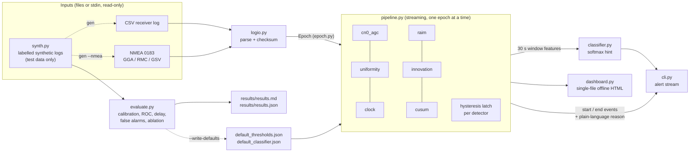

# GNSS-Sentinel

[](https://github.com/Kavin-Re/GNSS-Sentinel/actions/workflows/ci.yml)


A **defensive, passive, simulation-validated** toolkit that flags GNSS interference and spoofing *indicators* from
receiver-level measurements (C/N0, AGC, noise floor, satellite count, clock bias, position/velocity, residuals, multipath).

It reads logs. It never transmits, and it contains no signal-generation, RF or network code. The test-data generator emits
abstract feature arrays only (numbers per epoch), not waveforms or real-frequency signals. A unit test
(`tests/test_regressions.py::test_package_is_offline_and_receive_only`) fails the build if a network, serial, SDR or
subprocess module is ever imported by the package.

> **Status: validated on synthetic data only.** Every number in this repository comes from the repo's own generator.
> Nothing has been run against a real receiver or a recorded interference event. Treat alerts as situational-awareness
> hints, not proof, and read [Limits](#limits-read-first) before quoting any figure.

## Limits (read first)

* **All quantitative results are on SYNTHETIC data** from this repo's own generator. Thresholds and the classifier were fitted
  on the same generator family (different seeds), so the numbers are optimistic. A "shifted" noisier profile is included to show
  the sensitivity: false alarms rise from ~1.1/h to ~7/h (fused) and classifier accuracy falls from 0.95 to 0.83.
* Not validated on any real receiver or recorded interference. Real AGC/C/N0 reporting, antennas, multipath and clock steering differ.
* Scenario severity ranges are the author's choices; weak cases (small clock steps, slow drag, weak CW) are undetectable by design.
  Slow position drag is the weakest case (fused detection 0.74 nominal, 0.82 shifted, mostly via CUSUM that assumes Doppler velocity is not dragged too).
* A spoofer that keeps per-satellite power structure, geometry and clock consistent is not modelled and would evade these detectors.
* Alerts are indicators, not attribution. The softmax "hint" is a convenience, not evidence.
* NavIC/IRNSS-specific behaviour is **not modelled**. NMEA parsing accepts any 2-letter talker (incl. GI) by sentence type only.
* The first 60 epochs of every log are treated as a clean baseline. A log that starts under attack poisons its own baseline.

## Architecture



| Path | What it holds |
|---|---|
| `gnss_sentinel/epoch.py` | `Epoch` record: one receiver output interval |
| `gnss_sentinel/detectors.py` | the six detectors (baseline learning, score, explanation) |
| `gnss_sentinel/pipeline.py` | streaming pipeline, hysteresis latch, classifier features |
| `gnss_sentinel/classifier.py` | small softmax classifier (numpy) |
| `gnss_sentinel/logio.py` | CSV and NMEA readers/writers |
| `gnss_sentinel/synth.py` | synthetic scenario generator (test data only) |
| `gnss_sentinel/evaluate.py` | evaluation protocol and report writer |
| `gnss_sentinel/cli.py`, `dashboard.py` | command line and offline HTML dashboard |
| `tests/` | 38 unit tests (unittest style, run with pytest or `python -m unittest`) |
| `results/` | `results.md` and `results.json` from the committed evaluation run |
| `examples/` | generated logs (`clean`, `meacon`, `drag`) and one dashboard |

## Quick start

```bash
git clone https://github.com/Kavin-Re/GNSS-Sentinel.git && cd GNSS-Sentinel
python -m pip install -r requirements.txt          # numpy only

python -m gnss_sentinel stream examples/meacon.csv
```

Output (abridged, from the committed example; the scenario starts at t = 295 s):

```text
# GNSS-Sentinel: passive analysis. First 60 epochs form the baseline and are assumed clean.
[t=   296.0 s] ALERT   clock      score 33.9 (thr 6.5)  clock-bias increment deviates by +93.1 m (= +0.311 us, 33.9 sigma) from the recent drift; ...
[t=   301.0 s] ALERT   cn0_agc    score 5.3 (thr 3.8)  AGC +1.3 dB vs baseline; ... -> in-band power rise without C/N0 loss (added-signal-like, ...)
[t=   301.0 s] ALERT   raim       score 5.5 (thr 2.6)  residual test statistic 54.0 vs chi-square(8) expectation 8 (z=5.5); largest weighted residual on PRN 16 ...
[t=   301.0 s]   hint (synthetic-trained classifier, not evidence): meacon p=0.63
# processed 720 epochs; alert episodes: cn0_agc=1, uniformity=0, clock=1, raim=1, innovation=0, cusum=0
```

Open `examples/meacon_dashboard.html` in a browser for the same run as a timeline (no network access needed).

## Usage

```bash
python -m gnss_sentinel gen meacon -o m.csv [--nmea m.nmea] --seed 11 [--profile shifted]
python -m gnss_sentinel stream m.csv [--dashboard out.html] [--quiet] [--no-classifier]   # '-' = stdin; --format csv|nmea|auto
python -m gnss_sentinel dashboard m.csv -o out.html     # offline single-file HTML, alert timeline, no network
python -m gnss_sentinel evaluate [--quick] --out results_quick   # full run takes several minutes
python -m pytest -q                                     # or: python -m unittest discover -s tests
```

`evaluate` without `--quick` and with `--write-defaults` overwrites the packaged thresholds and classifier; leave that flag
off unless you mean to re-calibrate.

## Scenarios (labelled, synthetic)

`clean`, `jam_ramp` (wideband jamming ramp), `cw` (narrowband CW), `meacon` (meaconing-style common delay), `spoof_uniform`
(all satellites at the same power), `drag` (slow position drag). The generator also has a `sat_fault` option used for RAIM testing.
Each scenario is a statistical description of what a receiver *would report*, not a signal model.

## Detectors

| # | Name | Idea | Needs |
|---|---|---|---|
| 1 | `cn0_agc` | C/N0 drop (median, worst-3) plus AGC and noise-floor rise against a per-satellite baseline | C/N0; AGC/noise optional |
| 2 | `uniformity` | C/N0 spread collapse: all satellites at nearly the same power | C/N0 of 6+ satellites |
| 3 | `clock` | clock-bias increment jump against recent drift (robust sigma from MAD) | clock bias |
| 4 | `raim` | weighted residual chi-square consistency (Wilson-Hilferty z), names the largest-residual satellite | residuals, 5+ satellites |
| 5 | `innovation` | constant-velocity Kalman filter, normalised innovation squared over 5 epochs | position; velocity optional |
| 6 | `cusum` | Page test on position motion not explained by Doppler velocity | position and velocity |

Each detector is debounced and feeds a hysteresis latch (on above threshold, off after 3 epochs below 0.6 x threshold).
Thresholds are the 99th percentile of the per-run maximum score on 200 clean synthetic runs (`default_thresholds.json`).
Detectors whose input fields are absent report "n/a" (for example NMEA has no AGC, clock, residuals or multipath).

## Results (synthetic data only)

Copied from [`results/results.md`](results/results.md), which has every detector, the ablation, ROC AUC, confidence-interval
methods and confusion matrices. Run config: 200 calibration runs, 150 clean test runs, 100 test runs per attack (nominal),
40 runs per class (shifted); 720 epochs per run at 1 Hz; detection window 420 s after onset.

Fused detection (any detector), 95 % Wilson interval, and median delay of the detected runs:

| Scenario | Nominal: detected | Nominal: median delay | Shifted: detected | Shifted: median delay |
|---|---|---|---|---|
| `jam_ramp` | 1.00 [0.96, 1.00] | 25 s | 1.00 [0.91, 1.00] | 32 s |
| `cw` | 1.00 [0.96, 1.00] | 3 s | 1.00 [0.91, 1.00] | 3 s |
| `meacon` | 1.00 [0.96, 1.00] | 2 s | 0.97 [0.87, 1.00] | 4 s |
| `spoof_uniform` | 1.00 [0.96, 1.00] | 4 s | 1.00 [0.91, 1.00] | 6 s |
| `drag` | 0.74 [0.65, 0.82] | 46 s | 0.82 [0.68, 0.91] | 76 s |

| Metric | Nominal profile | Shifted profile |
|---|---|---|
| Fused false alarms on clean runs (episodes per hour, exact Poisson 95 % CI) | 1.13 [0.77, 1.60] over 27.5 h | 7.36 [5.53, 9.61] over 7.3 h |
| Classifier accuracy, one 30 s window per run (Wilson 95 % CI) | 0.95 [0.94, 0.97], n = 600 | 0.83 [0.78, 0.87], n = 240 |

How to read this: a detection rate of 1.00 means "the signature I modelled is separable from the clean runs I modelled", not
"this attack is always detected". The false-alarm rate rising about 6.5x under a modest change of noise profile is the more
important number. Two caveats on the evaluation itself are listed under [Known issues](#known-issues-and-roadmap).

## CSV format

Header-driven, `#` comments, empty cell = missing. Columns: `t,n_sat,agc_db,noise_db,clock_m,e_m,n_m,u_m,ve_mps,vn_mps,vu_mps,label`
then per slot k = 0..15: `prn{k},el{k},az{k},cn0{k},res{k},mp{k}`. `label` is optional ground truth and is never read by the detectors.

## NMEA

GGA, RMC and GSV only (checksums verified when present; the optional NMEA 4.10 signal-ID field is accepted). Sentences that fail
the checksum or cannot be parsed are skipped and counted in the run summary. Round-trip tested on the synthetic generator only;
untested against real receiver logs. Position/velocity resolution is limited by NMEA decimals (~0.19 m, ~0.05 m/s).

## Known issues and roadmap

* The committed `results/` were produced with 150 clean test runs, 50 training runs per class and 40 shifted runs per class;
  the current defaults in `evaluate.py` are 200 / 60 / 60, so a fresh full run will not reproduce the tables digit for digit.
* A run whose alert is already latched at onset (a false alarm just before the attack) is counted as a detection with zero
  delay; this slightly flatters detection rates and delays.
* Calibrating at the 99th percentile of the per-run maximum implies roughly 0.05 alert episodes per hour per detector; the
  held-out clean runs show 0.11 to 0.33 per hour for five of the six detectors, so the calibration is optimistic even in-family.
* Roadmap: validate on public recorded datasets and on a real receiver log (u-blox UBX-NAV/MON, Android GnssLogger);
  add a UBX or RINEX reader; replace the fixed 60-epoch baseline with a guarded, adaptive one; package with `pyproject.toml`.

## Licence

No licence file has been added yet, so default copyright applies (all rights reserved) until the author chooses one.
